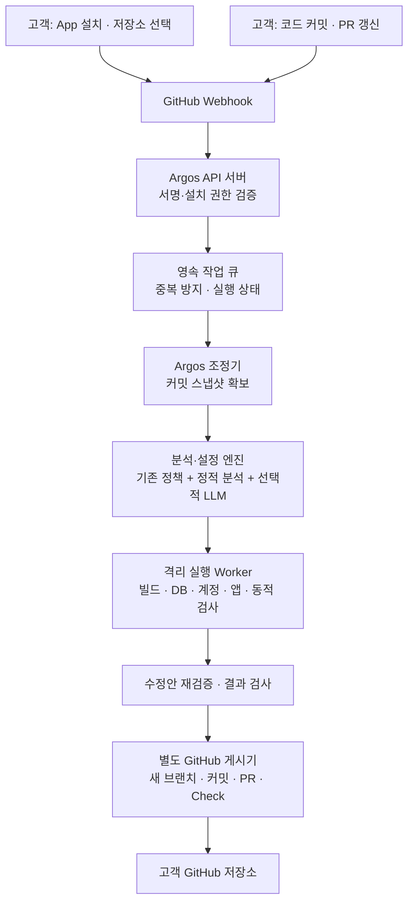

# GitHub App 기반 Argos 구현 계획

상태: 구현 전 계획. 고객 진입점은 GitHub App 설치와 검사할 저장소 선택이다. 고객에게 CLI 실행, Argos 설정 작성, GitHub Actions workflow 추가를 요구하지 않는다.

현재 부분 구현: 기존 OAuth 웹앱에서 허용된 PR을 노트북 Docker Worker로 보내 실제 검사·별도 댓글·상태를 만드는 연결은 [LOCAL_SANDBOX.md](LOCAL_SANDBOX.md)에 구현했다. GitHub App 설치 인증·설치 직후 검사·별도 결과 PR·Spring 지원까지 완료됐다는 의미는 아니다.

## 1. 고객에게 보이는 흐름

1. 고객이 Argos GitHub App을 설치하고 저장소를 선택한다.
2. Argos가 선택한 저장소의 기본 브랜치 최신 커밋으로 첫 검사를 시작한다.
3. 이후 커밋·사용자 PR 갱신을 감지해 자동 검사한다.
4. 새 Argos 브랜치와 PR에 쉬운 보고서·테스트 설정·검증된 수정안을 제공한다.
5. 고객은 생성된 PR에서 결과와 정책 가정을 검토한다. 수정이 없어도 설정·보고서 PR은 생성한다.

설치 권한 승인은 필요하지만, 테스트 환경·DB·계정 설정은 지원하는 스택에서 Argos가 준비한다. 미지원 구성은 임의로 성공 처리하지 않고 같은 결과 PR에 미검증 사유를 남긴다.

## 2. 전체 구조



Argos 서버가 자체 작업 큐와 일회성 Worker를 운영한다. GitHub Actions는 고객 도입의 필수 요소가 아니다. CLI와 GitHub App은 동일한 검사 엔진을 호출하는 서로 다른 진입점으로 둔다.

## 3. Argos 운영자가 최초 한 번 준비할 것

고객마다 App을 새로 등록하지 않는다. Argos 운영자가 하나의 GitHub App과 서비스 환경을 배포하고 고객이 이를 설치한다.

| 항목 | 준비 내용 |
|---|---|
| GitHub App | 공개 서비스 URL, HTTPS Webhook URL, 설치 가능 범위 등록 |
| 저장소 권한 | Contents read/write, Pull requests read/write, Checks read/write, Metadata read |
| 이벤트 | installation, installation_repositories, push, pull_request, check_run의 재실행 요청 |
| 서비스 비밀 | App ID·private key·Webhook secret을 서비스 비밀 저장소에 보관 |
| 실행 환경 | API 서버, 작업 조정기, 격리 Worker, 서비스 DB, 비공개 결과 저장소 |
| AI 설정 | 서비스가 승인한 모델·인증정보·전송 정책. 고객 프로젝트에서 API 키를 찾지 않음 |

Issues·Workflows·Administration 쓰기 권한은 첫 버전에 요구하지 않는다. GitHub App의 권한·이벤트는 실제 사용하는 API에 맞춰 검증한다. [GitHub App 권한 문서](https://docs.github.com/en/rest/authentication/permissions-required-for-github-apps)

LLM 외부 전송은 설치 과정에서 표시한 서비스 정책을 따른다. 별도 설정이 없으면 정적 규칙 경로를 사용하고, 고객이 원하지 않는 코드 전송을 자동으로 활성화하지 않는다.

## 4. Webhook 수신과 작업 생성

- 요청의 원본 body와 `X-Hub-Signature-256`으로 서명을 검증한다.
- 설치 ID와 저장소 ID를 서비스 DB의 허용 범위와 대조한다.
- 이벤트를 영속 저장·큐 등록한 뒤 응답한다. HTTP 요청 안에서 빌드·검사하지 않는다.
- `X-GitHub-Delivery`로 전달 중복을 제거한다.
- 실행 키는 설치·저장소·원본 SHA·게시 대상 브랜치·분석 버전으로 구성한다. 같은 변경의 push/PR 이벤트는 가능한 범위에서 하나로 합친다.
- Argos가 생성한 브랜치·커밋 기록을 확인해 자신의 결과 PR로 새 결과 PR을 만드는 루프를 막는다.
- 새 커밋이 오면 이전 작업을 대체 상태로 표시한다. 게시 직전 원본 브랜치 SHA를 재확인하고 오래된 결과로 코드 수정 PR을 만들지 않는다.
- 설치 삭제·저장소 접근 제거 시 대기 작업을 취소하고 실행 중 작업을 정리한다.

Webhook 서명은 이벤트 처리 전에 검증한다. [GitHub 공식 문서](https://docs.github.com/en/webhooks/using-webhooks/validating-webhook-deliveries)

## 5. 소스 확보와 자동 세팅

신뢰된 조정기가 해당 설치·저장소에 한정된 읽기 토큰으로 정확한 SHA의 스냅샷을 내려받는다. 토큰과 Git 인증 설정을 제거한 파일만 Worker에 전달한다. 장기 App private key는 Worker에 전달하지 않는다. 설치 토큰은 필요한 저장소·권한으로 축소해 발급한다. [설치 토큰 공식 문서](https://docs.github.com/en/apps/creating-github-apps/authenticating-with-a-github-app/generating-an-installation-access-token-for-a-github-app)

공통 파이프라인의 준비 단계는 다음과 같다.

1. 프레임워크·버전·빌드·DB·인증·API·조직 관계를 탐지한다.
2. 기존에 검토된 정책이 있으면 유지하고 새 API·변경 항목만 초안으로 추가한다.
3. 설정이 없으면 수동 YAML을 요구하지 않고 테스트 실행 계획을 생성한다.
4. 스택 어댑터가 일회성 DB·합성 데이터·사용자·유효한 인증을 준비한다.
5. 앱 기동과 정상 인증·자기 데이터 접근을 확인한 뒤 권한 검사를 실행한다.

현재 Express·SQLite 코드를 첫 어댑터로 사용한다. Spring Boot는 [SPRING_SUPPORT_PLAN.md](SPRING_SUPPORT_PLAN.md)의 Java·MVC·Security JWT·JPA·PostgreSQL 범위로 추가한다. 기술 스택 탐지 성공과 실제 지원 완료를 구분한다.

기대 권한은 현재 코드의 동작과 분리한다. 미확인 가설은 보고서에 남기고, 확인된 정책을 AI가 자동 완화하지 못하게 한다. PR이 단순 병합됐다는 이유만으로 모든 가설을 확인됨으로 바꾸지 않으며, 명시적인 정책 변경만 반영한다.

## 6. 실행·수정·보고의 경계

- 고객 코드·빌드·migration은 격리 Worker에서 실행한다. 호스트의 저장소 권한이나 클라우드 키를 제공하지 않는다.
- 정적 분석에서 SQL을 실행해야 한다면 그 작업도 격리한다. `init`의 호스트 SQL 실행을 먼저 제거한다.
- 로그인 성공은 기대 허용·실제 허용·주체 확인으로 증명한다. 기대 거부가 성공한 셀은 로그인 대조로 사용하지 않는다.
- 소스의 토큰 기본값을 테스트용이라고 가정해 복사하지 않는다. 실행별 테스트 자격증명을 준비하고 유효성을 확인한다.
- 외부 통신은 필요한 내부 앱·DB·issuer에만 허용하고 설치·게시 토큰은 Worker에 넣지 않는다.
- 자동 수정은 같은 정책·같은 테스트로 재검증한다. 미확인 정책에 의존하는 수정은 확인 필요 제안으로 남기며 검증된 보안 수정으로 확정하지 않는다.
- 정상 대조 실패, 관측 불가, 미지원 구성, 시간 초과는 검증 미완료로 보고한다. 실행 종료 코드만으로 안전을 선언하지 않는다.

격리 기본 정책은 [SANDBOX_PLAN.md](SANDBOX_PLAN.md)를 따르고 이 서비스의 실행 경계에 맞춰 갱신한다.

## 7. 결과 브랜치와 PR

고객 코드가 실행되는 환경과 분리한 게시기가 검증된 결과 파일만 받아 GitHub API로 게시한다. 현재 `gh`·로컬 Git 기반 게시기는 로컬 CLI용으로 유지하고 서비스용 API 게시기를 추가한다.

- 새 브랜치: `argos/result/<source-sha>-<run-id>`.
- 일반적인 동일 저장소 작업은 검사한 커밋에서 분기하고 해당 원본 브랜치를 PR 대상으로 한다.
- 설정·보고서·매트릭스와 검증된 수정만 커밋한다. 토큰·서명 키·DB·원본 응답·호스트 경로는 반출하지 않는다.
- 코드 수정이 없어도 보고서 커밋으로 PR을 만든다. 재시도 시 같은 실행의 브랜치·PR을 재사용하고 중복 생성하지 않는다.
- 분석 실패도 가능한 범위에서 미완료 보고서 PR로 남긴다. GitHub 쓰기 권한이 철회되거나 API 장애가 있으면 결과를 보관하고 게시 실패를 기록한다.
- 포크 PR은 설치 권한을 확인한다. 원본 브랜치에 게시할 권한이 없으면 설치된 저장소의 기본 브랜치에서 보고서 전용 PR을 만든다. 포크 코드를 기본 브랜치에 섞어 넣지 않는다.
- 게시 전 허용 경로·결과 스키마·파일 크기·비밀값을 검사한다. Worker의 임의 경로나 실행 파일을 게시기에서 실행하지 않는다.

PR 상단은 “무슨 데이터가 누구에게 보였는지, 무엇을 고쳤는지, 검증하지 못한 범위”를 쉬운 문장으로 표시한다. 기술 근거는 보고서에 둔다. Check에는 진행 상태와 원본 커밋의 결과를 표시하되 PR 생성을 대체하지 않는다. [브랜치 API](https://docs.github.com/en/rest/git/refs#create-a-reference), [PR API](https://docs.github.com/en/rest/pulls/pulls#create-a-pull-request), [Check API](https://docs.github.com/en/rest/checks/runs#create-a-check-run)

## 8. 추가할 모듈과 상태

아래 경로와 이름은 구현 제안이다.

| 영역 | 모듈 | 역할 |
|---|---|---|
| App 진입점 | `src/service/webhook.ts` | 서명 검증·이벤트 정규화·큐 등록 |
| 설치 인증 | `src/github/app.ts` | 설치 토큰·저장소 권한·스냅샷 확보 |
| 작업 관리 | `src/service/jobs.ts` | 영속 상태·lease·중복 제거·재시도·취소 |
| 공통 검사 엔진 | `src/pipeline/run.ts` | 자동 init → 준비 → scan → fix → report |
| 스택 지원 | `src/adapters/` | Express와 Spring의 분석·빌드·DB·인증 준비 |
| 격리 실행 | `src/service/worker.ts` | 일회성 작업 공간·자원 제한·결과 반출 |
| 게시 | `src/github/publish.ts` | 별도 브랜치·커밋·PR·Check |
| 배포 | `deploy/` | API·조정기·Worker·DB·결과 저장소 구성 |

첫 서비스는 TypeScript 코드를 재사용하고 PostgreSQL에 설치 정보·작업 상태·큐를 영속화한다. 결과 파일은 고객별 접근을 분리한 비공개 저장소에 둔다. 큐의 lease 만료, 실행별 재시도 상한, 전체 시간 예산을 둬 조정기 재시작 후 복구할 수 있게 한다.

```text
queued → preparing → scanning → verifying_fixes → reporting → publishing → completed
           └ 준비·검사 실패 → 미완료 보고서 → publishing
           └ 대체 커밋·설치 해제 → superseded / cancelled
           └ 인프라·게시 실패 → 제한된 재시도 → failed
```

원본 소스는 실행 종료 후 삭제한다. 결과의 보관 기간·삭제·조직 간 접근 차단을 서비스 정책으로 정하고 설치 해제 시 후속 정리 작업을 예약한다.

## 9. 구현 순서와 완료 기준

| 순서 | 결과물 | 완료 기준 |
|---|---|---|
| 0 | 기존 엔진 보완 | 호스트 SQL 실행·잘못된 로그인 성공·토큰 복사 회귀 테스트 통과 |
| 1 | App 등록·API·작업 큐 | 설치/커밋 이벤트가 인증된 작업 하나로 저장됨; 재전송 시 중복 없음 |
| 2 | 공통 자동 준비 엔진 | Argos 설정이 없는 Express fixture에서 설정·DB·인증·검사가 자동 완료됨 |
| 3 | 격리 Worker | 고객 코드가 서비스 비밀에 접근하지 못하고 실패·타임아웃 후 작업 공간이 정리됨 |
| 4 | 별도 게시기 | 취약/정상/미지원 결과 모두 새 보고 PR 생성; GitHub 장애 재시도 시 중복 없음 |
| 5 | Spring 어댑터 | 설정 없는 Spring fixture에서 빌드·PostgreSQL·실제 JWT·역할 검증까지 완료됨 |
| 6 | 설치부터 통합 검증 | 빈 설정의 고객 저장소에 App 설치 → 첫 PR; 이후 커밋 → 갱신 검사·새 결과 PR |

출시 검증에는 Webhook 위조·중복, 두 고객 간 격리, 원본 브랜치 이동, 포크 PR, 설치 해제, 게시 권한 부족, 정상 인증 실패, 미지원 프레임워크를 포함한다. 자동 수정이 없어도 보고 PR이 생겨야 한다.

## 10. 기존 문서·CLI와의 관계

이 문서가 설치형 제품의 진입점과 실행 위치를 정의한다. 기존 [CI 계획](../prd/11-ci-flow.md)은 검사 엔진·로컬 CI 실행에 참고하며, 고객에게 workflow 작성을 요구하는 방식은 이 제품 흐름의 필수 조건으로 두지 않는다.

`argos init`, `scan`, `fix`, `report`, `ci`는 개발·디버깅 및 재현용 CLI로 유지한다. GitHub App 서비스는 CLI 문자열을 조합하기보다 공통 TypeScript API를 호출한다. 이 계획 문서 추가는 App 등록이나 외부 배포가 완료됐다는 의미가 아니다.
