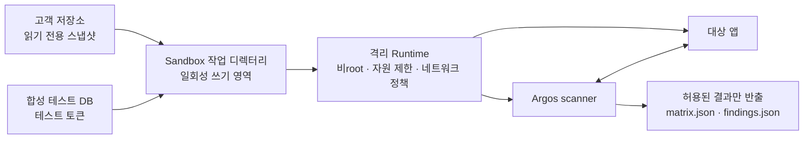

# Argos Sandbox Plan

## 목적

`argos scan`이 고객사 애플리케이션을 실행할 때 고객의 원본 코드·비밀값·호스트 환경을 보호한다. 현재의 임시 복사본 실행은 원본 수정을 막을 뿐 보안 Sandbox가 아니다. 고객사 코드를 대상으로 하는 scan은 격리 Sandbox 안에서만 실행하는 것을 목표로 한다.

## 범위와 비범위

| 구분 | 포함 |
|---|---|
| 포함 | 고객 코드 실행 격리, 테스트 DB/마커 시드, 네트워크 차단, 자원 제한, 결과 반출 제한 |
| 포함 | 코드 읽기 기반의 `argos init` 분석 격리 및 LLM 데이터 반출 통제 |
| 제외 | 운영 DB 직접 스캔, 운영 토큰 사용, 악성 코드 분석 서비스, 프로덕션 침투 테스트 |

**원칙:** 운영 데이터·운영 인증정보·개발자 개인 키는 Sandbox에 절대 전달하지 않는다. 테스트용 DB, 테스트 토큰, 합성 데이터만 사용한다.

## 현재 상태

현재 Runner는 다음을 제공한다.

- 대상 디렉터리를 `/tmp/argos-run-*`에 복사해 원본을 수정하지 않음
- 임시 `HOME`, `PORT`, 설정의 `target.env`만 자식 프로세스에 전달
- 앱 및 하위 프로세스를 종료하고 임시 폴더를 삭제

그러나 이는 보안 격리가 아니다. 대상 코드가 호스트 네트워크, 파일 시스템, CPU/메모리에 접근할 수 있으므로 신뢰할 수 없는 코드에는 사용하면 안 된다.

## 목표 아키텍처

앱과 Argos scanner는 같은 격리 네트워크 안에서만 통신한다. 외부 인터넷과 호스트 네트워크는 기본 차단한다.

## 위협 모델

| 위협 | 완화 정책 |
|---|---|
| 앱이 고객 원본을 변경 | 읽기 전용 소스 마운트, 별도 쓰기 작업 디렉터리 |
| 앱이 고객 비밀을 읽음 | `.env`, SSH 키, 클라우드 자격증명, CI 토큰을 Sandbox에 주입하지 않음 |
| 앱이 외부로 데이터를 전송 | 기본 egress 차단, scanner↔app 내부 통신만 허용 |
| 앱이 호스트를 제어 | 비root, Linux capability 제거, `no-new-privileges`, Docker socket 미마운트 |
| fork bomb/과도한 빌드 | CPU·메모리·PID·디스크·실행 시간 제한 |
| 결과에 비밀이 섞임 | 마커/비밀 마스킹, 허용 파일만 반출, 결과 검사 |
| AI 분석에 소스·비밀 반출 | 정적 분석 전용, 제외 목록·마스킹·egress 감사 로그 |

## 실행 모델

### 1. 입력 준비

1. 고객 저장소를 읽기 전용 스냅샷으로 준비한다.
2. `.env`, `.git`, `node_modules`, 비밀 파일, 빌드 산출물은 기본 제외한다.
3. 스키마와 테스트 전용 환경 변수만 작업 디렉터리에 제공한다.
4. 필요한 의존성은 사전 제작된 허용 이미지 또는 신뢰 가능한 캐시에서 제공한다.

### 2. Sandbox 생성

Sandbox마다 독립된 컨테이너 또는 microVM을 만든다.

- 실행 사용자: 비root UID/GID
- 소스: 읽기 전용 마운트
- 작업 디렉터리: 쓰기 가능, 실행 종료 후 삭제
- 루트 파일 시스템: 읽기 전용 우선
- 권한: capability drop, `no-new-privileges`, seccomp, AppArmor/SELinux 정책
- 호스트 제어 인터페이스: Docker socket, kubeconfig, SSH agent, `/proc` 민감 항목 미노출

### 3. 네트워크 정책

기본 정책은 외부 egress를 차단한다.

| 통신 | 정책 |
|---|---|
| scanner → 대상 앱 | 허용: Sandbox 내부의 지정 포트만 |
| 대상 앱 → scanner | 불필요하므로 차단 |
| 대상 앱 → 인터넷 | 차단 |
| 대상 앱 → 호스트/사설망 | 차단 |
| 패키지 설치 | scan 중 차단; 사전 빌드 이미지에서 해결 |

외부 API를 반드시 모킹해야 하면 허용 목록 기반의 내부 mock 서비스만 제공한다.

### 4. 자원 제한

초기 기본값은 고객 환경에 맞춰 조정 가능해야 한다.

| 리소스 | 초기 제한 |
|---|---:|
| 전체 실행 시간 | 5분 |
| 앱 준비 시간 | 30초 |
| CPU | 2 vCPU |
| 메모리 | 2 GiB |
| PID | 256 |
| 쓰기 디스크 | 2 GiB |
| 출력 로그 | 10 MiB |

제한 초과는 `SKIPPED` 또는 명시적 Sandbox 오류로 보고하며, 안전하다고 판정하지 않는다.

### 5. 결과 반출과 정리

반출 가능한 파일은 `matrix.json`, `findings.json`, 선택된 마스킹 로그로 한정한다. 전체 작업 디렉터리, DB 파일, 환경 덤프는 반출하지 않는다. 종료 시 앱 프로세스 그룹을 강제 종료하고 Sandbox 및 쓰기 볼륨을 삭제한다.

## `argos init`과의 연결

`argos init`은 고객 코드를 실행하지 않고 정적으로 분석한다.

1. OpenAPI, 라우트 정의, ORM 모델, DB 스키마, 인증 미들웨어를 탐색한다.
2. `.env`와 키 파일을 제외하고 비밀 패턴을 마스킹한다.
3. AI를 사용할 경우 전송 파일 목록·마스킹 정보를 `out/init-egress.json`에 기록한다.
4. AI는 테스트 페르소나, 리소스, 소유자 후보, 기대 권한의 **초안**만 만든다.
5. 생성된 설정은 Zod 검증 및 정적 분석 결과 대조를 통과해야 한다.

AI가 만든 토큰은 항상 `ARGOS_TEST_TOKEN_*` 같은 자리표시자다. 실제 고객 토큰을 추론하거나 생성하려 하지 않는다.

## 단계적 구현

### Phase 0 — 정책과 인터페이스

- `SandboxRunner` 인터페이스를 정의한다.
- `local`(개발 전용)과 `sandbox` 실행 모드를 분리한다.
- 고객 코드에 대한 `local` 실행을 거부하거나 명시적인 위험 승인 플래그를 요구한다.

### Phase 1 — 컨테이너 격리

- Docker/OCI runtime 기반의 일회성 컨테이너 Runner를 구현한다.
- 읽기 전용 소스, tmpfs 작업 공간, 비root, 네트워크 없음, 자원 제한을 적용한다.
- scanner와 대상 앱을 동일한 격리 네트워크에 기동한다.

### Phase 2 — 배포 환경 강화

- seccomp/AppArmor 또는 SELinux 프로필을 적용한다.
- 사전 빌드된 언어별 이미지(Node, Python 등)를 제공한다.
- 서명된 이미지와 취약점 스캔을 CI에 추가한다.

### Phase 3 — 고신뢰 실행

- 다중 고객·공유 호스트 환경에서는 Firecracker 등 microVM 격리를 검토한다.
- 네트워크 정책, 감사 로그, 이미지 공급망 검증을 중앙 정책으로 관리한다.

## 검증 기준

Sandbox 구현은 아래 테스트를 통과해야 한다.

- 앱이 소스 마운트에 파일을 쓰려 하면 실패한다.
- 앱이 `/etc`, 사용자 홈, 클라우드 메타데이터 주소, 인터넷에 접근하지 못한다.
- `.env`·SSH 키·클라우드 자격증명이 컨테이너에서 존재하지 않는다.
- 무한 루프, 메모리 과다 사용, 과도한 프로세스 생성이 제한 안에서 종료된다.
- scanner는 내부 대상 앱에는 접근할 수 있다.
- 결과에는 전체 마커·비밀값·작업 DB가 포함되지 않는다.
- 타임아웃과 앱 오류는 `OK`가 아닌 오류 또는 `SKIPPED`로 기록된다.

## 운영 정책

- 고객 대상 scan은 Sandbox 모드가 기본이자 필수다.
- 개발자가 자신의 신뢰 가능한 로컬 프로젝트를 검사할 때만 `local` 모드를 쓸 수 있다.
- Sandbox 이미지·정책·런타임 버전은 결과 메타데이터에 기록한다.
- 새로운 언어 런타임이나 외부 서비스 의존성은 별도 Sandbox 프로파일 검토 후 허용한다.
