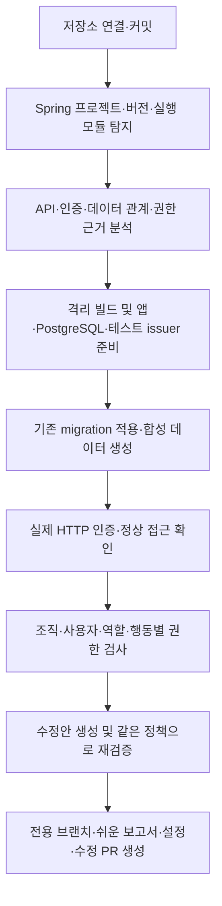

# Spring 자동 세팅 지원 계획

상태: 구현 전 설계. 목표는 고객이 Argos 설정·테스트 계정·DB 시드를 직접 작성하지 않아도, 저장소 연결 후 CI에서 권한 검증과 별도 결과 PR 생성까지 진행하는 것이다.

## 첫 지원 범위

Spring Framework 생태계의 첫 실행 대상으로 Spring Boot 애플리케이션을 지원한다. Boot를 사용하지 않는 Spring MVC/WAR 배포는 후속 어댑터로 분리한다.

| 영역 | 첫 지원 범위 | 후속 확장 |
|---|---|---|
| 언어 | Java | Kotlin |
| 프레임워크 | Spring Boot + Servlet MVC | Boot 없는 Spring, WebFlux |
| 빌드 | Maven / Gradle, 프로젝트 버전·toolchain 탐지 | 복잡한 멀티모듈·사내 빌드 플러그인 |
| 인증 | 표준 OAuth2 Resource Server JWT | 커스텀 JWT 필터, 세션 로그인·CSRF, 외부 SSO |
| 인가 | SecurityFilterChain, 활성화된 메서드 보안, 서비스·Repository 소유권 검사 | 커스텀 AuthorizationManager, 외부 정책 엔진 |
| 데이터 | JPA + PostgreSQL, Flyway 또는 Liquibase | MySQL, MyBatis, 다중 DataSource |

프로젝트의 Spring/Java 버전은 유지한다. 자동 업그레이드하지 않으며, 지원 여부는 검증된 fixture 버전 목록으로 관리한다. 첫 fixture는 Boot 3.x 기반으로 고정하고 Boot 4.x는 별도 호환성 검증을 거친다.

## 고객 경험

지원하지 않는 구성이거나 준비에 실패해도 분석 결과와 미검증 범위를 PR로 남긴다. 고객에게 수동 YAML 작성을 기본 경로로 요구하지 않는다.

## 1. 정적 분석: 사실과 기대 정책 분리

Java 구문 분석기로 구조화된 사실을 수집하고, LLM은 연결 관계와 불확실한 후보를 해석한다. LLM이 반환한 파일·심볼·컬럼은 분석 결과와 대조한다.

- 빌드: `pom.xml`, `build.gradle`, `build.gradle.kts`, wrapper 설정, toolchain, 실행 모듈.
- API: 클래스·메서드의 RequestMapping 계열, HTTP 메서드, 경로 변수, DTO, Bean Validation 제약.
- 인증: SecurityFilterChain 선택·순서, JWT decoder 설정, principal 및 authority 변환.
- 인가: requestMatchers, 역할·authority 조건, PreAuthorize/PostAuthorize, 서비스와 Repository의 소유권 조건.
- 데이터: Entity, PK/FK, 사용자·조직·멤버십·리소스 관계, migration, DTO에 노출되는 필드.
- 환경: 필요한 설정 키와 의존 서비스의 종류만 추출. 설정값은 비밀 여부 검사 후 처리.

`@PreAuthorize` 발견만으로 권한 보호가 활성화됐다고 판단하지 않는다. 메서드 보안 활성화와 호출 경로를 함께 확인한다. Spring은 요청 수준과 메서드 수준 인가를 구분하며, 메서드 보안은 별도로 활성화해야 한다. [공식 문서](https://docs.spring.io/spring-security/reference/servlet/authorization/method-security.html)

각 기대 정책에는 `근거 위치`, `확인 상태`, `적용 범위`를 기록한다. 기존에 검토된 정책은 새 코드에 맞춰 자동 완화하지 않는다. 현재 구현에서 추출한 동작과 LLM 추론은 검토된 정책과 별도로 보관한다. 근거가 부족한 교차 조직 접근은 관측 사실과 정책 확인 필요 사항을 함께 보고한다.

`.env`뿐 아니라 `application*.yml`, properties, Java 코드 안의 하드코딩 비밀도 LLM 전송 전에 제외·마스킹한다. 저장소 내용은 분석 대상 데이터로 취급하며, 그 안의 지시가 실행 권한이나 전송 정책을 변경하지 못하게 한다.

## 2. 실행 환경 자동 생성

1. 저장소의 Java·Spring·빌드 도구 버전에 맞는 격리 빌드 환경을 선택한다.
2. Maven/Gradle 및 플러그인도 고객 코드로 간주해 격리 환경에서만 실행한다. 의존성은 제한된 저장소 프록시·캐시로 공급하고 호스트 자격증명은 전달하지 않는다.
3. 산출된 JAR, 전용 PostgreSQL, 테스트 JWT issuer를 일회성 검증 환경에 배치한다.
4. 외부에서 주입하는 Argos 전용 설정으로 DB 주소·테스트 issuer·서버 포트를 지정한다. `PORT`만 전달하면 Spring이 자동 반영한다고 가정하지 않는다.
5. 운영 프로필의 보안 필터·인가 서비스·JWT claim 변환은 유지하고, 변경한 환경 설정은 기록한다.
6. readiness 경로를 탐지하고 실제 준비 상태를 확인한다. `/health`나 Actuator가 항상 존재하거나 익명 접근 가능하다고 가정하지 않는다.

앱·DB·issuer는 실행별 내부 네트워크에서 통신한다. 외부·호스트·다른 실행으로의 연결은 차단한다. 컨테이너 수명 관리는 신뢰된 Argos 조정기가 맡으며, 고객 앱·빌드 컨테이너에 Docker socket을 제공하지 않는다.

준비 단계와 스캔 단계의 시간 예산을 구분한다. 현재 Node 데모의 준비 시간 제한을 Java 빌드에 그대로 적용하지 않는다. 준비 실패는 제한된 재시도 후 원인과 미검증 범위를 보고하며, 호스트 실행으로 자동 전환하지 않는다.

## 3. PostgreSQL과 합성 데이터

DB는 고객 프로젝트의 migration으로 생성한다. Flyway/Liquibase가 있으면 이를 사용하고, 임의로 SQLite/H2로 바꾸거나 `ddl-auto=create`를 강제하지 않는다. Hibernate만 쓰는 프로젝트는 원래 스키마 생성 방식의 지원 여부를 별도 검증한다. Spring도 schema 생성 방식을 하나로 유지하도록 안내한다. [공식 문서](https://docs.spring.io/spring-boot/how-to/data-initialization.html)

생명주기는 DB 생성 → migration 완료 확인 → 합성 데이터 삽입 → 앱 준비·인증 확인 순서로 제어한다. 앱 기동 중 migration이 실행되는 프로젝트도 중복 schema 생성 없이 처리한다.

시드는 FK 순서, UUID/sequence, NOT NULL, unique, enum, 멤버십 관계를 만족해야 한다. 생성된 ID는 요청의 경로·본문·쿼리에 각각 연결한다. 이메일·제목 등 형식 제약이 있는 컬럼은 유효한 합성 값을 사용하며, 마커는 응답에 노출되는 적절한 필드에 심는다.

기본 데이터는 두 조직, 조직별 관리자와 일반 사용자, 같은 조직의 다른 소유자, 익명 요청을 포함한다. 공유 리소스는 정책 근거가 있을 때 추가한다. DB 비밀번호와 테스트 계정 정보는 실행 중에만 보관하고 PR에는 넣지 않는다.

## 4. 실제로 통과하는 인증 준비

첫 버전은 표준 JWT Resource Server에 한정한다.

- 실행별 서명 키와 내부 issuer/JWKS를 생성한다.
- 앱이 사용하는 claim·authority 변환과 사용자/멤버십 연결을 분석한다.
- Sandbox 전용 신뢰 설정으로 issuer·공개 키를 연결하되, 서명·만료·issuer 및 기존 audience 검사를 유지한다.
- 각 테스트 사용자의 실제 서명된 JWT를 만들고 HTTP 요청으로 인증을 검증한다.
- 정상 토큰의 자기 데이터 접근과 함께 잘못된 서명·만료 토큰의 거부를 확인한다.

이 검증은 테스트 issuer 아래의 앱 인증·인가 경로를 대상으로 한다. 고객의 외부 IdP 자체가 검증됐다고 표현하지 않는다. 커스텀 decoder·필터 때문에 동일한 인증 경로를 구성하지 못하면 자동 세팅 미지원으로 보고한다.

Resource Server는 JWT 검증과 authority 변환을 수행한다. [공식 문서](https://docs.spring.io/spring-security/reference/servlet/oauth2/resource-server/jwt.html) MockMvc의 `jwt()`는 mock 인증 정보를 공급하는 보조 검사로 활용할 수 있지만, 실제 HTTP JWT 검증의 대체 증거로 사용하지 않는다. [MockMvc 공식 문서](https://docs.spring.io/spring-security/reference/servlet/test/mockmvc/oauth2.html)

## 5. 권한 매트릭스와 보고

매트릭스를 `주체 × 대상 조직 × 대상 소유자 × 리소스 × 행동`으로 확장한다. 조직 소유와 사용자 소유를 구분하고 역할/authority 조건을 표현한다.

- 다른 조직의 단건·목록·중첩 리소스 접근.
- 같은 조직의 다른 사용자 데이터 접근.
- 일반 사용자의 관리자 전용 API 실행.
- 익명 및 유효하지 않은 토큰의 접근.
- 목록·검색·페이지네이션·내보내기의 데이터 혼입.
- 응답 DTO·오류 응답의 비밀 노출.

데이터 수정 검사는 일회성 DB와 차단된 외부 부작용이 확인된 범위에서만 수행한다. 읽기 요청에서도 외부 부작용 가능성을 고려한다. 쓰기 권한은 상태 코드만 보지 않고 DB 상태 등으로 실제 변경 여부를 확인한다.

정상 주체의 대조 요청이 실패하면 공격 차단을 안전 근거로 쓰지 않는다. 응답에 마커가 없다는 이유만으로 미노출을 확정하지 않으며, 직렬화·필터링 등으로 관측할 수 없는 리소스는 검증 불충분으로 표시한다.

PR에는 쉬운 영향 설명, 근거, 재검증 결과, 전체 발견 API 대비 실행·미실행 범위를 포함한다. 확정되지 않은 정책과 단순 환경 오류를 취약점으로 혼합하지 않는다. 검증된 코드 수정이 없어도 설정·보고서 PR을 생성한다.

권한 정책과 테스트 범위는 수정 전후 동일하게 고정한다. AI가 테스트를 삭제하거나 기대 권한을 완화해서 수정 성공을 만들지 못하게 한다.

## 현재 코드와의 연결

현재 기반은 `src/init/` 미구현, SQLite 시드, Bearer/anonymous 인증, `owner/other/anonymous` 기대값이다. 컨테이너 실행은 기본 Node 이미지와 컨테이너 내부 Node 중계기에 의존한다. 따라서 Java 이미지만 바꿔서는 Spring 지원이 완성되지 않는다.

| 변경 영역 | 필요한 기능 |
|---|---|
| `src/init/` | Spring 탐지, 구조화된 분석, 근거 있는 설정·실행 계획 생성 |
| Config | DB 종류, 실행 시점 인증 참조, 역할·소유자·행동 조건, 요청 데이터 바인딩 |
| Seed | PostgreSQL adapter, migration 생명주기, 제약을 만족하는 관계 시드 |
| Runner/Container | 격리 Java 빌드·실행, 내부 의존 서비스, Node 없는 JVM 통신 |
| HTTP/Matrix | 경로 변수별 ID, DTO 본문·쿼리 생성, 역할 검사, 정상 대조·상태 변경 검증 |
| CI/PR | 자동 준비 연결, 미검증 범위 보고, 설정·보고서 PR, 재귀 실행·중복 방지 |

PR 게시 단계는 고객 코드 실행 단계와 분리한다. Git/PR 쓰기 자격증명을 고객 앱·빌드·LLM에 전달하지 않는다.

## 구현 순서와 완료 기준

1. **Spring fixture:** Java + Boot MVC + Security JWT + JPA + PostgreSQL + migration 조합을 만든다. 정상 앱과 의도적 권한 결함 변형을 마련한다.
2. **구조 분석:** Maven/Gradle, Controller, Security, Entity, migration에서 자동 실행 계획을 생성한다.
3. **환경 준비:** 격리 빌드·DB·issuer·시드를 기동하고 정상 인증·접근 대조를 통과시킨다.
4. **동적 검증:** 조직·사용자·역할·행동별 공격과 민감값 검사를 실행한다.
5. **CI 연결:** 고객 설정 없이 전용 브랜치와 보고 PR을 생성한다.

완료 조건은 Argos 설정이 없는 fixture 저장소에서 위 흐름이 끝까지 성공하는 것이다. Maven/Gradle 각각 검증하고, 다음 실패 사례도 확인한다.

- 조직 검사 누락, 역할 검사 누락을 각각 재현한다.
- PreAuthorize가 있어도 메서드 보안이 비활성화된 변형을 탐지한다.
- 정상 앱에서는 권한 위반을 잘못 보고하지 않는다.
- 잘못된 인증, migration 실패, 미지원 보안 구성은 미검증으로 남긴다.
- 생성한 요청이 유효한 DTO·서로 다른 경로 ID를 사용한다.
- 실행 후 DB·토큰·키·컨테이너를 정리하고 결과에 비밀이 남지 않는다.

Sandbox 전체 정책은 [SANDBOX_PLAN.md](SANDBOX_PLAN.md)를 따른다. 이 문서는 Spring 자동 준비에 필요한 구체적인 구현 계획이며, 지원 완료를 의미하지 않는다.
